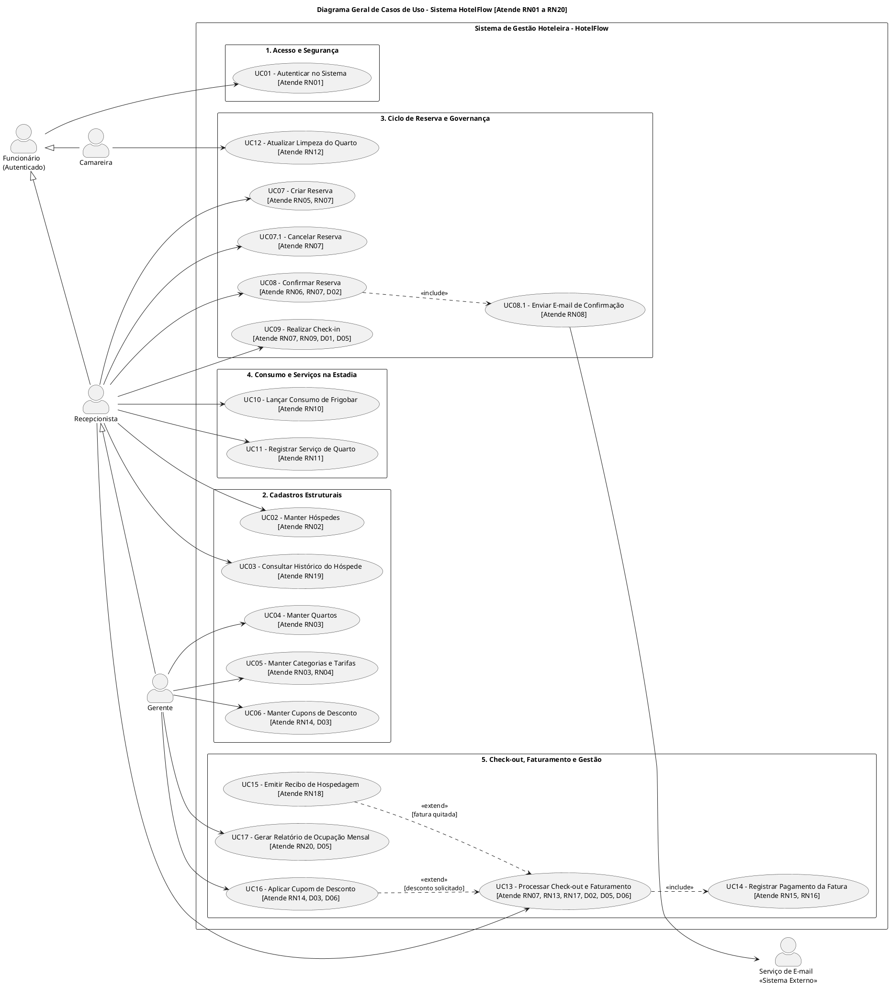

# Etapa E2 – Identificação de Atores, Fronteiras e Diagrama Geral de Casos de Uso
**Projeto:** HotelFlow – Sistema de Gestão Hoteleira (SENAC)  
**Entregáveis cobertos (AOO):** Identificação dos atores, fronteira do sistema e Diagrama Geral de Casos de Uso (`[Atende RN01..RN20]`)

---

## 1. Definição da Fronteira do Sistema (*System Boundary*)

A **fronteira do sistema** delimita o que é responsabilidade automatizada pelo software **HotelFlow** e o que pertence ao ambiente externo (pessoas ou sistemas integrados):

- **Dentro da Fronteira (Escopo do HotelFlow):** Controle de autenticação por perfil (`[Atende RN01]`), cadastros de hóspedes/quartos/tarifas/cupons (`[Atende RN02, RN03, RN04, RN14]`), criação/cancelamento/confirmação de reservas com bloqueio de sobreposição (`[Atende RN05, RN06, RN07]`), efetivação de check-in e governança de limpeza (`[Atende RN09, RN12]`), lançamento de consumos e serviços (`[Atende RN10, RN11]`), geração automática de fatura com congelamento histórico (`[Atende RN13, D06]`), registro de pagamentos integrais ou fracionados (`[Atende RN15, RN16]`), liberação pós-quitação e emissão textual de recibo (`[Atende RN17, RN18]`), histórico de reservas finalizadas e relatório gerencial de ocupação mensal (`[Atende RN19, RN20]`).
- **Fora da Fronteira (Ambiente Externo):** Funcionários que operam o sistema (`Recepcionista`, `Gerente`, `Camareira`), o servidor externo de disparo de mensagens eletrônicas (`Serviço de E-mail` — `[Atende RN08]`) e o próprio `Hóspede` no balcão físico.

> [!IMPORTANT]
> **Justificativas Acadêmicas de Escopo (`[Atende RN01]`):**
> 1. **Por que `Hóspede` NÃO é Ator Primário?** Pela `RN01`, o sistema é uma plataforma interna operada exclusivamente por funcionários autenticados (`Recepcionista`, `Gerente`, `Camareira`). Não há portal de autoatendimento para o cliente; portanto, `Hospede` é uma **Classe de Domínio (Entidade)** operada pela recepção.
> 2. **Por que não há Caso de Uso "Manter Usuários"?** Em respeito estrito ao escopo (`RN01` exige autenticação e controle de acesso por perfil, enquanto apenas `RN02` e `RN03` exigem telas de manutenção de cadastro), as credenciais dos funcionários são provisionadas na carga inicial (*seed*) do banco de dados, sem inventar requisitos extras.

---

## 2. Catálogo de Atores Identificados

| Ator | Classificação UML | Descrição e Responsabilidades | Rastreabilidade |
| :--- | :--- | :--- | :--- |
| **Funcionário (Autenticado)** | Primário (Abstrato) | Papel base que generaliza qualquer colaborador com credenciais de login e senha ativas no sistema. | `[Atende RN01]` |
| **Camareira** | Primário (Especializado) | Colaboradora da governança responsável por inspecionar e atualizar o status de higienização dos quartos (`Sujo`, `Em Limpeza`, `Limpo`). | `[Atende RN01, RN12]` |
| **Recepcionista** | Primário (Especializado) | Colaborador de linha de frente responsável pelo atendimento ao hóspede: cadastros de clientes, reservas, check-in, lançamentos de estadia, check-out, recebimentos e recibos. | `[Atende RN01, RN02, RN05..RN11, RN13, RN15..RN19]` |
| **Gerente** | Primário (Especializado) | Gestor do hotel. **Herda** todas as capacidades operacionais da `Recepcionista` (`D04`) e detém exclusividade sobre cadastros estruturais (`Quartos`, `Tarifas`, `Cupons`), concessão de descontos em faturas e relatórios gerenciais. | `[Atende RN01, RN03, RN04, RN14, RN20, D03, D04]` |
| **Serviço de E-mail** | Secundário (`<<Sistema Externo>>`) | Servidor/provedor externo acionado pelo HotelFlow para entrega automática do e-mail de confirmação da reserva ao endereço eletrônico do hóspede. | `[Atende RN08]` |

---

## 3. Justificativa dos Relacionamentos UML Adotados

1. **Generalização (Herança) entre Atores (`<|--`):**
   - `Funcionário <|-- Camareira` e `Funcionário <|-- Recepcionista`: evita ligar todos os atores repetidamente ao `UC01 - Autenticar no Sistema` (`[Atende RN01]`).
   - `Recepcionista <|-- Gerente` (`[Atende D04]`): expressa formalmente na UML que o `Gerente` herda todos os casos de uso da `Recepcionista`, mantendo o diagrama limpo e sem linhas cruzadas.
2. **Separação entre `UC07 (Criar Reserva)` e `UC07.1 (Cancelar Reserva)` (`[Atende RN05, RN07]`):**
   - Garante alta coesão funcional: criar reserva exige associar hóspede, quarto e datas previstas (`RN05`), enquanto cancelar atua sobre uma reserva já existente alterando seu ciclo de vida (`RN07`).
3. **Relacionamento `<<include>>` (Inclusão Obrigatória):**
   - Seta tracejada partindo do **caso base** para o **caso incluído** (sempre executado):
     - `UC08 (Confirmar Reserva)` $\dashrightarrow$ `<<include>>` $\dashrightarrow$ `UC08.1 (Enviar E-mail de Confirmação)` (`[Atende RN08]`): toda confirmação dispara obrigatoriamente a notificação por e-mail.
     - `UC13 (Processar Check-out e Faturamento)` $\dashrightarrow$ `<<include>>` $\dashrightarrow$ `UC14 (Registrar Pagamento da Fatura)` (`[Atende RN15, RN16]`): todo processamento de check-out passa pelo registro de pagamento (integral ou parcial, visto que `D06` limita descontos a `< 100%`).
4. **Relacionamento `<<extend>>` (Extensão Condicional):**
   - Seta tracejada partindo do **caso extensor** para o **caso base**, executada apenas se a condição de guarda for verdadeira:
     - `UC16 (Aplicar Cupom de Desconto)` $\dashrightarrow$ `<<extend>> [desconto solicitado]` $\dashrightarrow$ `UC13` (`[Atende RN14, D06]`): ocorre opcionalmente quando o `Gerente` informa um cupom válido antes do primeiro pagamento.
     - `UC15 (Emitir Recibo de Hospedagem)` $\dashrightarrow$ `<<extend>> [fatura quitada]` $\dashrightarrow$ `UC13` (`[Atende RN16, RN18]`): como a `RN16` permite pagamento parcial encerrando o atendimento sem quitação, o recibo **não** é incondicional (`<<include>>`); ele estende o `UC13` exclusivamente quando o saldo devedor zera (`StatusFatura == PAGA`).

---

## 4. Catálogo Rastreável de Casos de Uso (`UC01` a `UC17`)

| Código | Nome do Caso de Uso | Ator Principal | Requisitos Atendidos |
| :--- | :--- | :--- | :--- |
| **UC01** | Autenticar no Sistema | Funcionário | `[Atende RN01]` |
| **UC02** | Manter Hóspedes | Recepcionista | `[Atende RN02]` |
| **UC03** | Consultar Histórico do Hóspede | Recepcionista | `[Atende RN19]` |
| **UC04** | Manter Quartos | Gerente | `[Atende RN03, D04]` |
| **UC05** | Manter Categorias e Tarifas | Gerente | `[Atende RN03, RN04, D04]` |
| **UC06** | Manter Cupons de Desconto | Gerente | `[Atende RN14, D03, D04]` |
| **UC07** | Criar Reserva | Recepcionista | `[Atende RN05, RN07]` |
| **UC07.1** | Cancelar Reserva | Recepcionista | `[Atende RN07]` |
| **UC08** | Confirmar Reserva | Recepcionista | `[Atende RN06, RN07, D02]` |
| **UC08.1** | Enviar E-mail de Confirmação | *(Incluído por UC08)* / Serviço de E-mail | `[Atende RN08]` |
| **UC09** | Realizar Check-in | Recepcionista | `[Atende RN07, RN09, D01, D05]` |
| **UC10** | Lançar Consumo de Frigobar | Recepcionista | `[Atende RN10]` |
| **UC11** | Registrar Serviço de Quarto | Recepcionista | `[Atende RN11]` |
| **UC12** | Atualizar Limpeza do Quarto | Camareira | `[Atende RN12]` |
| **UC13** | Processar Check-out e Faturamento | Recepcionista | `[Atende RN07, RN13, RN17, D02, D05, D06]` |
| **UC14** | Registrar Pagamento da Fatura | *(Incluído por UC13)* | `[Atende RN15, RN16]` |
| **UC15** | Emitir Recibo de Hospedagem | *(Estende UC13 se quitada)* | `[Atende RN16, RN18]` |
| **UC16** | Aplicar Cupom de Desconto | Gerente *(Estende UC13)* | `[Atende RN14, D03, D06]` |
| **UC17** | Gerar Relatório de Ocupação Mensal | Gerente | `[Atende RN20, D05]` |

---

## 5. Código PlantUML Consolidado

Arquivo-fonte oficial mantido em: [E2_Casos_de_Uso_Geral.puml](diagramas/E2_Casos_de_Uso_Geral.puml)

