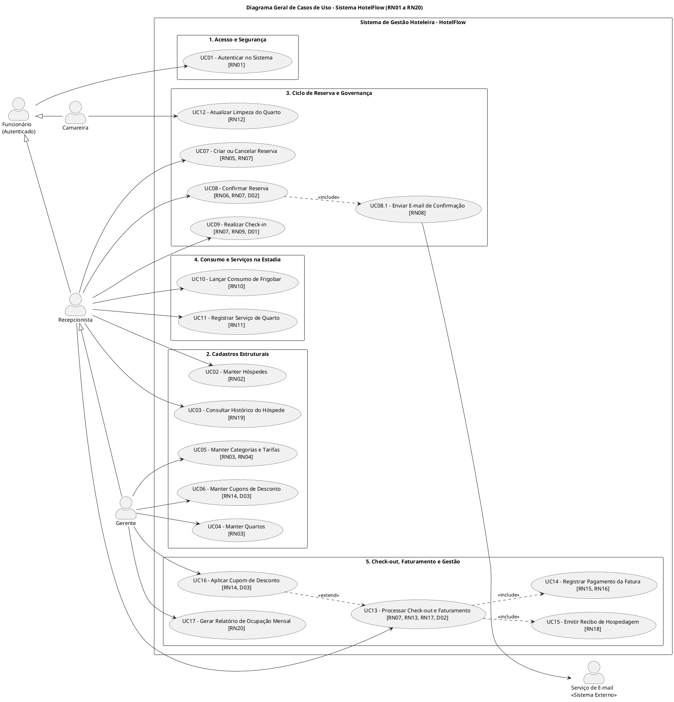

# Etapa E2 – Identificação de Atores, Fronteiras e Diagrama Geral de Casos de Uso
**Projeto:** HotelFlow – Sistema de Gestão Hoteleira (SENAC)  
**Entregáveis cobertos (AOO):** Itens `2 - Identificação dos atores e fronteiras` e `3 - Diagrama de casos de uso`

---

## 1. Definição da Fronteira do Sistema (*System Boundary*)

A **fronteira do sistema** delimita o que é responsabilidade automatizada pelo software **HotelFlow** e o que pertence ao ambiente externo (pessoas ou outros sistemas):

- **Dentro da Fronteira (Escopo do HotelFlow):** Controle de autenticação por perfil, cadastros de hóspedes/quartos/tarifas/cupons, validação de conflito de agenda nas reservas, controle de status de ocupação e limpeza, lançamento de consumos e serviços, cálculo automático de faturas, registro de pagamentos (integrais ou fracionados), emissão textual de recibos e cálculo gerencial de ocupação mensal (`RN01` a `RN20`).
- **Fora da Fronteira (Ambiente Externo):** Funcionários que operam o teclado/tela (`Recepcionista`, `Gerente`, `Camareira`), o servidor externo de disparo de mensagens eletrônicas (`Serviço de E-mail`) e o próprio `Hóspede` no balcão físico.

> [!IMPORTANT]
> **Justificativa Acadêmica – Por que o `Hóspede` NÃO é um Ator Primário no Diagrama de Casos de Uso?**  
> Pela **RN01**, o sistema é uma plataforma interna de gestão hoteleira operada exclusivamente por funcionários autenticados (`Recepcionista`, `Gerente` e `Camareira`). Não existe no escopo um aplicativo ou portal de autoatendimento onde o hóspede faça login para reservar quartos sozinho. Portanto, na UML, **`Hospede` é uma Classe de Domínio (Entidade)** cujos dados são cadastrados pela `Recepcionista`, e não um Ator Primário que interage diretamente com a interface do sistema.

---

## 2. Catálogo de Atores Identificados

| Ator | Classificação UML | Descrição e Responsabilidades | Rastreabilidade |
| :--- | :--- | :--- | :--- |
| **Funcionário (Autenticado)** | Primário (Abstrato) | Papel base que generaliza qualquer colaborador com credenciais de login e senha ativas no sistema. | `RN01` |
| **Camareira** | Primário (Especializado) | Colaboradora da governança responsável por inspecionar e atualizar o status de higienização dos quartos (`Sujo`, `Em Limpeza`, `Limpo`). | `RN01`, `RN12` |
| **Recepcionista** | Primário (Especializado) | Colaborador de linha de frente responsável pelo atendimento ao hóspede: cadastros de clientes, reservas, check-in, lançamentos de estadia, check-out, recebimentos e recibos. | `RN01`, `RN02`, `RN05`–`RN11`, `RN13`, `RN15`–`RN19` |
| **Gerente** | Primário (Especializado) | Gestor do hotel. **Herda** todas as capacidades operacionais da `Recepcionista` (`D04`) e detém exclusividade sobre cadastros estruturais (`Quartos`, `Tarifas`, `Cupons`), concessão de descontos em faturas e relatórios gerenciais. | `RN01`, `RN03`, `RN04`, `RN14`, `RN20`, `D03`, `D04` |
| **Serviço de E-mail** | Secundário (`<<Sistema Externo>>`) | Servidor/provedor externo acionado pelo HotelFlow para entrega automática do e-mail de confirmação da reserva ao endereço eletrônico do hóspede. | `RN08` |

---

## 3. Justificativa dos Relacionamentos UML Adotados

Para avaliação em banca de Análise Orientada a Objetos, destacam-se três decisões estruturais no diagrama:

1. **Generalização (Herança) entre Atores (`<|--`):**
   - `Funcionário <|-- Camareira` e `Funcionário <|-- Recepcionista`: Evita ligar todos os atores repetidamente ao `UC01 - Autenticar no Sistema` (`RN01`).
   - `Recepcionista <|-- Gerente` (`D04`): Representa fielmente a hierarquia hoteleira sem poluir o diagrama com dezenas de linhas duplicadas saindo do `Gerente`. Na UML, o `Gerente` herda automaticamente os casos de uso da `Recepcionista`.
2. **Relacionamento `<<include>>` (Inclusão Obrigatória):**
   - A seta tracejada parte do **caso de uso base** em direção ao **caso de uso incluído**, indicando que o comportamento incluído **sempre** é executado:
     - `UC08 (Confirmar Reserva)` $\dashrightarrow$ `<<include>>` $\dashrightarrow$ `UC08.1 (Enviar E-mail de Confirmação)` (`RN08`): toda confirmação de reserva dispara obrigatoriamente o envio de e-mail.
     - `UC13 (Processar Check-out e Faturamento)` $\dashrightarrow$ `<<include>>` $\dashrightarrow$ `UC14 (Registrar Pagamento da Fatura)` (`RN15`, `RN16`) e `UC15 (Emitir Recibo de Hospedagem)` (`RN18`): o encerramento completo do check-out exige quitar os pagamentos e emitir o recibo textual.
3. **Relacionamento `<<extend>>` (Extensão Condicional/Opcional):**
   - A seta tracejada parte do **caso opcional** em direção ao **caso base**, indicando execução **apenas se uma condição for satisfeita**:
     - `UC16 (Aplicar Cupom de Desconto)` $\dashrightarrow$ `<<extend>>` $\dashrightarrow$ `UC13 (Processar Check-out e Faturamento)` (`RN14`): a maioria dos check-outs ocorre sem desconto; somente quando há um cupom apresentado e validado pelo `Gerente` esse comportamento estende o faturamento.

---

## 4. Catálogo Rastreável de Casos de Uso (`UC01` a `UC17`)

| Código | Nome do Caso de Uso | Ator Principal | Requisitos Atendidos |
| :--- | :--- | :--- | :--- |
| **UC01** | Autenticar no Sistema | Funcionário | `RN01` |
| **UC02** | Manter Hóspedes | Recepcionista | `RN02` |
| **UC03** | Consultar Histórico do Hóspede | Recepcionista | `RN19` |
| **UC04** | Manter Quartos | Gerente | `RN03`, `D04` |
| **UC05** | Manter Categorias e Tarifas | Gerente | `RN03`, `RN04`, `D04` |
| **UC06** | Manter Cupons de Desconto | Gerente | `RN14`, `D03`, `D04` |
| **UC07** | Criar ou Cancelar Reserva | Recepcionista | `RN05`, `RN07` |
| **UC08** | Confirmar Reserva | Recepcionista | `RN06`, `RN07`, `D02` |
| **UC08.1** | Enviar E-mail de Confirmação | *(Incluído por UC08)* / Serviço de E-mail | `RN08` |
| **UC09** | Realizar Check-in | Recepcionista | `RN07`, `RN09`, `D01` |
| **UC10** | Lançar Consumo de Frigobar | Recepcionista | `RN10` |
| **UC11** | Registrar Serviço de Quarto | Recepcionista | `RN11` |
| **UC12** | Atualizar Limpeza do Quarto | Camareira | `RN12` |
| **UC13** | Processar Check-out e Faturamento | Recepcionista | `RN07`, `RN13`, `RN17`, `D02` |
| **UC14** | Registrar Pagamento da Fatura | *(Incluído por UC13)* | `RN15`, `RN16` |
| **UC15** | Emitir Recibo de Hospedagem | *(Incluído por UC13)* | `RN18` |
| **UC16** | Aplicar Cupom de Desconto | Gerente *(Estende UC13)* | `RN14`, `D03` |
| **UC17** | Gerar Relatório de Ocupação Mensal | Gerente | `RN20` |

---

## 5. Código PlantUML (Pronto para Renderização)

Arquivo fonte salvo em: `docs/diagramas/E2_Casos_de_Uso_Geral.puml`

