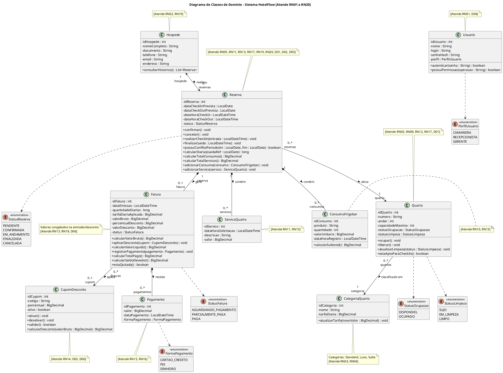

# Etapa E5 – Diagrama de Classes de Domínio
**Projeto:** HotelFlow – Sistema de Gestão Hoteleira (SENAC)  
**Disciplinas Integradas:** Análise Orientada a Objetos (AOO) e Programação Orientada a Objetos (POO)  
**Código-fonte PlantUML:** [E5_Diagrama_de_Classes.puml](file:///home/cauez/hotelaria/docs/diagramas/E5_Diagrama_de_Classes.puml) (`[Atende RN01..RN20, D01..D06]`)

---

## 1. Visão Arquitetural do Modelo de Domínio

O Diagrama de Classes consolida as **10 entidades de domínio** e **6 enumerações tipadas** extraídas na [Etapa E4](file:///home/cauez/hotelaria/docs/E4_Analise_Gramatical_Abbott.md), seguindo rigorosamente os princípios de **Domínio Rico** (evitando modelos anêmicos) e **Alta Coesão / Baixo Acoplamento (GRASP)**:

- As referências entre objetos (`hospede`, `quarto`, `categoria`, `consumos`, `servicos`, `fatura`, `cupom`, `pagamentos`) são representadas diretamente como **papéis (*role names*) nas extremidades das associações UML**, evitando duplicar chaves estrangeiras dentro das caixas de atributos conceituais.
- Componentes de infraestrutura, geração textual de comprovantes (`GeradorReciboService` — `RN18`), envio de e-mail (`EmailService` — `RN08`) e agregações analíticas mensais (`RelatorioOcupacaoService` — `RN20`) não poluem as entidades de domínio e serão alocados na camada `service` na Etapa `E9`.

---

## 2. Catálogo e Justificativa Acadêmica dos Relacionamentos UML

| Classe Origem | Classe Destino | Tipo UML | Multiplicidade | Navegabilidade e Justificativa Acadêmica | Rastreabilidade |
| :--- | :--- | :---: | :---: | :--- | :--- |
| **`Hospede`** | **`Reserva`** | Associação | `1` — `0..*` | **Bidirecional (`<-->`):** uma `Reserva` exige `1` titular (`Hospede`), e o `Hospede` navega para suas `0..*` reservas para filtrar as `FINALIZADA`s em `consultarHistorico()`. | `[Atende RN02, RN05, RN19]` |
| **`Reserva`** | **`Quarto`** | Associação | `0..*` — `1` | **Unidirecional (`-->`):** toda `Reserva` aloca exatamente `1` `Quarto`; ao longo do tempo, um `Quarto` participa de `0..*` reservas sem depender existencialmente delas. | `[Atende RN03, RN05, RN06, RN09]` |
| **`Quarto`** | **`CategoriaQuarto`** | Associação | `0..*` — `1` | **Unidirecional (`-->`) — Por que NÃO Agregação (`o--`)?** `CategoriaQuarto` (`Standard`, `Luxo`, `Suíte`) é um *descritor/classificação* (*Item-Descriptor Pattern*), não um contêiner físico todo-parte. Um quarto é *classificado em* uma categoria, não "parte" dela. | `[Atende RN03, RN04]` |
| **`Reserva`** | **`ConsumoFrigobar`** | **Composição (`*--`)** | `1` — `0..*` | **Todo-Parte Exclusivo:** um lançamento de frigobar só existe dentro da conta da `Reserva` que o originou e não pode migrar entre reservas. Linha independente (sem tronco compartilhado). | `[Atende RN10, RN13]` |
| **`Reserva`** | **`ServicoQuarto`** | **Composição (`*--`)** | `1` — `0..*` | **Todo-Parte Exclusivo:** serviços solicitados pertencem exclusivamente à estadia daquela `Reserva`. | `[Atende RN11, RN13]` |
| **`Reserva`** | **`Fatura`** | **Composição (`*--`)** | `1` — `0..1` | **Bidirecional dentro do Agregado:** reservas `PENDENTE`/`CANCELADA` possuem `0` faturas; no check-out gera-se no máximo `1` `Fatura` (`0..1`), que conhece sua `Reserva` para consolidar diárias e extras. *(No BD, registros contábeis não sofrem exclusão física).* | `[Atende RN07, RN13, RN16, D06]` |
| **`Fatura`** | **`Pagamento`** | **Composição (`*--`)** | `1` — `0..*` | **Todo-Parte Exclusivo:** suporta pagamentos únicos ou fracionados (`0..*`) vinculados exclusivamente àquela `Fatura`. | `[Atende RN15, RN16]` |
| **`Fatura`** | **`CupomDesconto`** | Associação | `0..*` — `0..1` | **Unidirecional (`-->`):** o desconto é opcional (`0..1` por fatura), e um mesmo cupom promocional ativo (ex.: `SENAC10`) pode ser aplicado em `0..*` faturas distintas. | `[Atende RN14, D03, D06]` |

---

## 3. Decisões de Encapsulamento e Invariantes de Domínio

1. **Dois Estados Ortogonais em `Quarto` (`[Atende RN09, RN12, RN17, D01]`):**
   - Separar `statusOcupacao` (`DISPONIVEL`, `OCUPADO`) de `statusLimpeza` (`SUJO`, `EM_LIMPEZA`, `LIMPO`) evita explosão combinatória de estados e modela com exatidão o pós-check-out (`RN17`: `DISPONIVEL` + `SUJO`) e a trava de entrada (`D01`: `estaAptoParaCheckIn()` retorna `true` somente quando `DISPONIVEL && LIMPO`).
2. **Datas Previstas vs. Datas Efetivas em `Reserva` (`[Atende RN05, RN06, RN09, RN13, RN20, D02, D05]`):**
   - `dataCheckInPrevista` e `dataCheckOutPrevista` governam o agendamento e o método `possuiConflitoPeriodo(ini, fim)` (intervalo semiaberto `[ini, fim)`: saída no dia 15 não conflita com nova entrada no dia 15).
   - `dataHoraCheckIn` e `dataHoraCheckOut` registram os momentos reais da hospedagem, garantindo precisão no cálculo de diárias efetivas (`calcularDiarias`, mínimo de 1 diária) e na taxa de ocupação mensal (`RN20`).
3. **Congelamento Contábil em `Fatura` (`[Atende RN04, RN13, RN14, RN16, RN19, D06]`):**
   - Ao emitir a fatura ou aplicar um `CupomDesconto`, `Fatura` grava `quantidadeDiarias`, `tarifaDiariaAplicada`, `valorBruto`, `percentualDesconto` e `valorDesconto`. Assim, reajustes futuros em `CategoriaQuarto.tarifaDiaria` ou desativação/edição de `CupomDesconto` jamais adulteram faturas históricas (`RN19`).
   - `aplicarDesconto(cupom)` lança exceção de negócio se `calcularTotalPago() > 0` (`status != AGUARDANDO_PAGAMENTO`), impedindo saldo devedor negativo após pagamentos parciais.

---

## 4. Matriz de Rastreabilidade do Modelo de Domínio

| Requisito | Elementos do Diagrama de Classes que Atendem |
| :--- | :--- |
| **RN01** | `Usuario` (`login`, `senhaHash`, `autenticar`, `possuiPermissao`) e `PerfilUsuario` |
| **RN02** | `Hospede` (`nomeCompleto`, `documento`, `telefone`, `email`, `endereco`) |
| **RN03, RN04** | `Quarto` (`numero`, `andar`, `capacidadeMaxima`) e `CategoriaQuarto` (`nome`, `tarifaDiaria`, `atualizarTarifa`) |
| **RN05, RN06** | `Reserva` (`dataCheckInPrevista`, `dataCheckOutPrevista`, `possuiConflitoPeriodo`) + associações com `Hospede` e `Quarto` |
| **RN07** | `Reserva` (`status`, `confirmar`, `cancelar`, `realizarCheckIn`, `finalizar`) e `StatusReserva` |
| **RN08** | Evento disparado na confirmação de `Reserva` utilizando `Hospede.email` *(orquestrado por `ReservaService` + `EmailService`)* |
| **RN09** | `Reserva.realizarCheckIn()`, `Quarto.estaAptoParaCheckIn()`, `Quarto.ocupar()` e `StatusOcupacao` |
| **RN10** | Composição `Reserva *-- ConsumoFrigobar` (`produto`, `quantidade`, `valorUnitario`, `calcularSubtotal`, `adicionarConsumo`) |
| **RN11** | Composição `Reserva *-- ServicoQuarto` (`dataHoraSolicitacao`, `descricao`, `valor`, `adicionarServico`) |
| **RN12** | `Quarto.atualizarLimpeza(status)` e `StatusLimpeza` (`SUJO`, `EM_LIMPEZA`, `LIMPO`) |
| **RN13** | `Fatura` (`calcularValorBruto`), `Reserva` (`calcularDiarias`, `calcularTotalConsumos`, `calcularTotalServicos`) e `CategoriaQuarto` |
| **RN14** | `CupomDesconto` (`codigo`, `percentual`, `ativo`, `validar`, `calcularDesconto`) e `Fatura.aplicarDesconto(cupom)` |
| **RN15, RN16** | Composição `Fatura *-- Pagamento`, `FormaPagamento`, `StatusFatura` e métodos `registrarPagamento`, `calcularTotalPago`, `calcularSaldoDevedor`, `estaQuitada` |
| **RN17** | `Reserva.finalizar()`, `Quarto.liberar()` (`DISPONIVEL`) e `Quarto.atualizarLimpeza(SUJO)` |
| **RN18** | Dados consolidados de `Fatura`, `Pagamento`, `Reserva` e `Hospede` *(formatados por `GeradorReciboService`)* |
| **RN19** | Associação `Hospede <--> Reserva` e `Hospede.consultarHistorico()` filtrando `StatusReserva.FINALIZADA` |
| **RN20** | Períodos efetivos em `Reserva` (`dataHoraCheckIn`, `dataHoraCheckOut`) e total de `Quarto`s *(apurados por `RelatorioOcupacaoService`)* |

---

## 5. Código PlantUML Consolidado

*(Espelho exato do arquivo [E5_Diagrama_de_Classes.puml](file:///home/cauez/hotelaria/docs/diagramas/E5_Diagrama_de_Classes.puml))*

