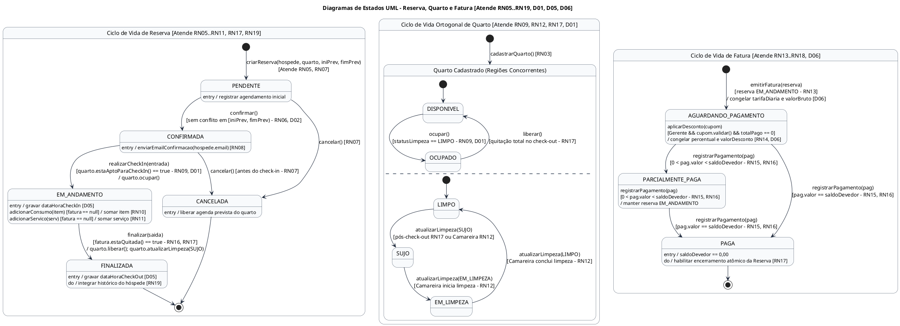

# Etapa E6 – Diagramas de Estados UML (`Reserva`, `Quarto` e `Fatura`)
**Projeto:** HotelFlow – Sistema de Gestão Hoteleira (SENAC)  
**Disciplinas Integradas:** Análise Orientada a Objetos (AOO) e Programação Orientada a Objetos (POO)  
**Código-fonte PlantUML:** [E6_Diagrama_de_Estados.puml](diagramas/E6_Diagrama_de_Estados.puml) (`[Atende RN05..RN19, D01, D02, D05, D06]`)

---

## 1. Objetivo e Justificativa Acadêmica

Na UML 2.5, o **Diagrama de Máquinas de Estados (*State Machine Diagram*)** modela o comportamento reativo de objetos cujo método de negócio depende crucialmente do **estado atual**, protegendo transições por meio de **eventos**, **condições de guarda (`[guarda]`)** e **ações/efeitos (`/ ação`)**.

No domínio do **HotelFlow**, três classes concentram todas as regras de transição de estado exigidas pelo escopo:
1. **`Reserva`** (`StatusReserva` — `[Atende RN05..RN11, RN17, RN19]`): governa desde o agendamento inicial até a integração ao histórico pós-quitação;
2. **`Quarto`** (`StatusOcupacao` $\times$ `StatusLimpeza` — `[Atende RN03, RN09, RN12, RN17, D01]`): modelado com **Regiões Ortogonais Concorrentes** (*Harel Statecharts*), pois ocupação e limpeza coexistem de forma independente;
3. **`Fatura`** (`StatusFatura` — `[Atende RN13..RN18, D06]`): controla o congelamento inicial, a janela válida para aplicação de cupom e a amortização integral ou fracionada.

---

## 2. Detalhamento das Máquinas de Estado

### 2.1 Ciclo de Vida de `Reserva` (`[Atende RN05..RN11, RN17, RN19, D01, D02, D05]`)

| Estado Origem | Evento (Método) | Condição de Guarda `[...]` | Ação / Efeito `/` | Estado Destino | Rastreabilidade |
| :--- | :--- | :--- | :--- | :--- | :--- |
| `[*]` *(Inicial)* | `criarReserva(...)` | Datas previstas válidas (`ini <= fim`) | Instancia reserva | `PENDENTE` | `[Atende RN05, RN07]` |
| `PENDENTE` | `confirmar()` | Sem reserva ativa sobreposta no quarto em `[iniPrev, fimPrev)` | Dispara e-mail de confirmação ao hóspede | `CONFIRMADA` | `[Atende RN06, RN07, RN08, D02]` |
| `PENDENTE` | `cancelar()` | — | Libera agenda prevista | `CANCELADA` | `[Atende RN07]` |
| `CONFIRMADA` | `cancelar()` | Antes da efetivação do check-in | Libera agenda prevista | `CANCELADA` | `[Atende RN07]` |
| `CONFIRMADA` | `realizarCheckIn(entrada)` | `quarto.estaAptoParaCheckIn()` (`DISPONIVEL && LIMPO`) | Grava `dataHoraCheckIn`; executa `quarto.ocupar()` | `EM_ANDAMENTO` | `[Atende RN07, RN09, D01, D05]` |
| `EM_ANDAMENTO` | `adicionarConsumo(item)` / `adicionarServico(serv)` | `fatura == null` *(conta ainda não fechada)* | Anexa despesa à reserva *(transição interna)* | `EM_ANDAMENTO` | `[Atende RN10, RN11, D06]` |
| `EM_ANDAMENTO` | `finalizar(saida)` | `fatura != null && fatura.estaQuitada()` | Grava `dataHoraCheckOut`; `quarto.liberar()`; `quarto.atualizarLimpeza(SUJO)` | `FINALIZADA` | `[Atende RN07, RN17, RN19, D05]` |

> [!IMPORTANT]
> **Transições Proibidas (Invariantes Protegidas no Domínio Java):**
> - Não é permitido `realizarCheckIn()` diretamente a partir de `PENDENTE` (exige passar por `CONFIRMADA`, garantindo a validação `RN06` e o e-mail `RN08`).
> - Não é permitido `cancelar()` uma reserva `EM_ANDAMENTO` ou `FINALIZADA` (uma vez iniciada a hospedagem, o encerramento ocorre via check-out e faturamento).

---

### 2.2 Ciclo de Vida Ortogonal de `Quarto` (`[Atende RN03, RN09, RN12, RN17, D01]`)

> **Por que usar Regiões Concorrentes (`--`) em vez de um único Enum?**  
> Se fundíssemos ocupação e limpeza em um só estado, teríamos $2 \times 3 = 6$ estados cartesianos (`DisponivelLimpo`, `DisponivelSujo`, `DisponivelEmLimpeza`, `OcupadoLimpo`, `OcupadoSujo`, `OcupadoEmLimpeza`). Na UML 2.5, o estado composto com **duas regiões ortogonais** expressa de forma enxuta que o `Quarto` está simultaneamente em um estado de **Ocupação** e em um estado de **Limpeza**, sincronizando-se nos pontos de fronteira:
> - **Sincronismo no Check-in (`D01`):** `DISPONIVEL` $\rightarrow$ `OCUPADO` exige a guarda `[statusLimpeza == LIMPO]`.
> - **Sincronismo no Check-out (`RN17`):** a quitação dispara simultaneamente `OCUPADO` $\rightarrow$ `DISPONIVEL` (Região 1) e `LIMPO` $\rightarrow$ `SUJO` (Região 2), exigindo atuação da `Camareira` (`SUJO` $\rightarrow$ `EM_LIMPEZA` $\rightarrow$ `LIMPO` — `RN12`) antes do próximo check-in!

---

### 2.3 Ciclo de Vida de `Fatura` (`[Atende RN13..RN18, D06]`)

| Estado Origem | Evento (Método) | Condição de Guarda `[...]` | Ação / Efeito `/` | Estado Destino | Rastreabilidade |
| :--- | :--- | :--- | :--- | :--- | :--- |
| `[*]` *(Inicial)* | `emitirFatura(reserva)` | `reserva.status == EM_ANDAMENTO` | Calcula e congela `quantidadeDiarias`, `tarifaDiariaAplicada` e `valorBruto` | `AGUARDANDO_PAGAMENTO` | `[Atende RN13, D06]` |
| `AGUARDANDO_PAGAMENTO` | `aplicarDesconto(cupom)` | Perfil `GERENTE`, `cupom.validar()` e `totalPago == 0` | Congela `percentualDesconto` e `valorDesconto` *(transição interna)* | `AGUARDANDO_PAGAMENTO` | `[Atende RN14, D03, D06]` |
| `AGUARDANDO_PAGAMENTO` | `registrarPagamento(pag)` | `0 < pag.valor < saldoDevedor` | Adiciona parcela; recalcula saldo restante | `PARCIALMENTE_PAGA` | `[Atende RN15, RN16]` |
| `AGUARDANDO_PAGAMENTO` | `registrarPagamento(pag)` | `pag.valor == saldoDevedor` *(pagamento único integral)* | Zera saldo; habilita encerramento atômico da reserva (recibo emitido após commit) | `PAGA` | `[Atende RN15, RN16, RN17, RN18]` |
| `PARCIALMENTE_PAGA` | `registrarPagamento(pag)` | `0 < pag.valor < saldoDevedor` *(nova parcela parcial)* | Acumula pagamento mantendo saldo pendente *(auto-transição)* | `PARCIALMENTE_PAGA` | `[Atende RN15, RN16]` |
| `PARCIALMENTE_PAGA` | `registrarPagamento(pag)` | `pag.valor == saldoDevedor` *(parcela final quitadora)* | Zera saldo; habilita encerramento atômico da reserva (recibo emitido após commit) | `PAGA` | `[Atende RN15, RN16, RN17, RN18]` |

---

## 3. Código PlantUML Consolidado

*(Espelho exato do arquivo [E6_Diagrama_de_Estados.puml](diagramas/E6_Diagrama_de_Estados.puml))*

