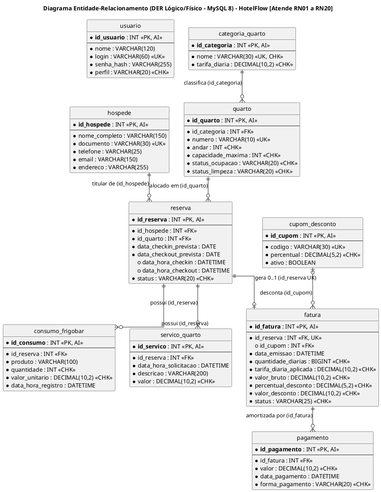

# Etapa E8 – Modelagem Lógica e Física de Banco de Dados (MySQL 8)
**Projeto:** HotelFlow – Sistema de Gestão Hoteleira (SENAC)  
**Disciplinas Integradas:** Análise Orientada a Objetos (AOO) e Programação Orientada a Objetos (POO)  
**Artefatos Físicos:**
- **DER PlantUML:** [E8_DER_Logico_Fisico.puml](file:///home/cauez/hotelaria/docs/diagramas/E8_DER_Logico_Fisico.puml) | **Prancha Visual:** [E8_DER_Logico_Fisico.pdf](file:///home/cauez/hotelaria/docs/diagramas/E8_DER_Logico_Fisico.pdf)
- **Script DDL (Estrutura):** [01_schema_hotelflow.sql](file:///home/cauez/hotelaria/sql/01_schema_hotelflow.sql)
- **Script DML (Seed Inicial):** [02_seed_dados_iniciais.sql](file:///home/cauez/hotelaria/sql/02_seed_dados_iniciais.sql)

---

## 1. Estratégia de Mapeamento Objeto-Relacional (ORM Manual / JDBC)

O esquema relacional em **MySQL 8.0+ (`InnoDB`, `utf8mb4_0900_ai_ci`)** traduz de forma bijetora (`1:1`) as **10 classes de domínio** e **6 enumerações** definidas na [Etapa E5](file:///home/cauez/hotelaria/docs/E5_Diagrama_de_Classes.md). Abaixo estão as **5 decisões de engenharia de dados** adotadas e suas justificativas para avaliação acadêmica:

1. **Padrão de Nomenclatura (`CamelCase` $\leftrightarrow$ `snake_case`) e Chaves Substitutas (*Surrogate Keys*):**
   - Classes Java em `PascalCase` e atributos em `camelCase` mapeiam para tabelas e colunas em `snake_case` no singular (ex.: `ConsumoFrigobar.valorUnitario` $\rightarrow$ `consumo_frigobar.valor_unitario`).
   - Todas as tabelas utilizam `INT AUTO_INCREMENT` como chave primária substituta (`PK`), mantendo chaves de negócio naturais (`usuario.login`, `hospede.documento`, `quarto.numero`, `cupom_desconto.codigo`) protegidas por constraints **`UNIQUE` (`UK`)**. Isso evita cascatas caras caso um hóspede corrija erro de digitação em seu passaporte/CPF (`RN02`).

2. **Mapeamento de `Enums` Java via `VARCHAR` + `CHECK` (MySQL 8.0.16+):**
   - **Por que `VARCHAR(...) CHECK (...)` em vez do tipo proprietário `ENUM(...)` do MySQL?**  
     O tipo `ENUM` nativo do MySQL armazena índices inteiros internos (`1, 2, 3...`), dificultando evolução de esquema (`ALTER TABLE` reconstrói a tabela), ordenando pelo índice interno em vez do texto e podendo gravar string vazia `''` em certos modos SQL. No MySQL 8.0.16+, constraints **`CHECK` são validadas nativamente pelo motor InnoDB**, combinando integridade estrita no banco com leitura limpa via `Enum.valueOf(rs.getString(...))` no JDBC!

3. **Composição UML (`*--`) vs. Política `ON DELETE RESTRICT` no Banco (`[Atende RN16, RN19]`):**
   - No Diagrama de Classes (`E5`), `Reserva *-- ConsumoFrigobar`, `Reserva *-- ServicoQuarto`, `Reserva *-- Fatura` e `Fatura *-- Pagamento` são **Composições** (a parte não existe sem o todo: `FK NOT NULL`).
   - Porém, no DDL físico usamos deliberadamente **`ON DELETE RESTRICT`** (e **não** `ON DELETE CASCADE`): em um sistema hoteleiro e contábil real (`RN19`), reservas e faturas **nunca sofrem `DELETE` físico** (mudam de estado para `CANCELADA` ou `FINALIZADA`). `ON DELETE RESTRICT` impede que qualquer comando acidental apague em cascata registros financeiros auditáveis!

4. **Multiplicidade `1 : 0..1` entre `Reserva` e `Fatura` garantida por `UNIQUE (id_reserva)` (`[Atende RN13, RN16, D06]`):**
   - Na tabela `fatura`, a coluna `id_reserva INT NOT NULL` possui simultaneamente `FOREIGN KEY` e `CONSTRAINT uk_fatura_reserva UNIQUE (id_reserva)`. Isso torna **fisicamente impossível** criar duas faturas para a mesma reserva durante retomadas de pagamento parcial (`FA01`).

5. **Precisão Monetária Exata (`BigDecimal` $\leftrightarrow$ `DECIMAL(10,2)`):**
   - Valores financeiros jamais usam `FLOAT` ou `DOUBLE` (sujeitos a dízimas binárias IEEE 754). Utilizamos `DECIMAL(10, 2)` para valores monetários e `DECIMAL(5, 2)` para percentuais, mapeando sem perda de centavos para `java.math.BigDecimal`.

---

## 2. Dicionário Consolidado de Tabelas e Rastreabilidade (`RN01` a `RN20`)

| # | Tabela Física | Classe Java (`model`) | PK | FKs e UKs Principais | Constraints `CHECK` (MySQL 8) | Requisitos Atendidos |
| :-: | :--- | :--- | :--- | :--- | :--- | :--- |
| 1 | `usuario` | `Usuario` | `id_usuario` | `UK(login)` | `perfil IN ('CAMAREIRA','RECEPCIONISTA','GERENTE')` | `[Atende RN01, D04]` |
| 2 | `hospede` | `Hospede` | `id_hospede` | `UK(documento)` | — | `[Atende RN02, RN19]` |
| 3 | `categoria_quarto` | `CategoriaQuarto` | `id_categoria` | `UK(nome)` | `nome IN ('Standard','Luxo','Suíte')`; `tarifa_diaria > 0` | `[Atende RN03, RN04]` |
| 4 | `quarto` | `Quarto` | `id_quarto` | `FK(id_categoria)`, `UK(numero)` | `andar >= 0`; `capacidade_maxima > 0`; `status_ocupacao`; `status_limpeza` | `[Atende RN03, RN09, RN12, RN17, D01]` |
| 5 | `cupom_desconto` | `CupomDesconto` | `id_cupom` | `UK(codigo)` | `percentual > 0 AND percentual < 100` | `[Atende RN14, D03, D06]` |
| 6 | `reserva` | `Reserva` | `id_reserva` | `FK(id_hospede)`, `FK(id_quarto)` | `status`; `checkout_prev >= checkin_prev`; coerência de datas efetivas | `[Atende RN05..RN09, RN13, RN17, RN19, RN20, D02, D05]` |
| 7 | `consumo_frigobar` | `ConsumoFrigobar` | `id_consumo` | `FK(id_reserva)` | `quantidade > 0`; `valor_unitario > 0` | `[Atende RN10, RN13]` |
| 8 | `servico_quarto` | `ServicoQuarto` | `id_servico` | `FK(id_reserva)` | `valor > 0` | `[Atende RN11, RN13]` |
| 9 | `fatura` | `Fatura` | `id_fatura` | `FK+UK(id_reserva)`, `FK(id_cupom)` | `quantidade_diarias >= 1`; `valor_desconto < valor_bruto`; `status` | `[Atende RN13..RN18, D06]` |
| 10 | `pagamento` | `Pagamento` | `id_pagamento` | `FK(id_fatura)` | `valor > 0`; `forma_pagamento IN ('CARTAO_CREDITO','PIX','DINHEIRO')` | `[Atende RN15, RN16]` |

---

## 3. Índices Estratégicos e Consultas SQL Críticas (Prontas para o `DAO` na `E9`/`E10`)

### 3.1 Bloqueio de Sobreposição de Reservas (`[Atende RN06, D02]`)
- **Índice utilizado:** `idx_reserva_conflito (id_quarto, status, data_checkin_prevista, data_checkout_prevista)`
- **Lógica Matemática de Intervalo Semiaberto `[ini, fim)` (`D02`):**  
  Dois períodos `[iniA, fimA)` e `[iniB, fimB)` possuem sobreposição se, e somente se, `iniA < fimB AND fimA > iniB` (com tratamento especial caso ambos sejam *day-use* de mesmo dia `ini == fim`). Assim, um check-out previsto para `2026-12-08` **não bloqueia** um novo check-in em `2026-12-08`:

```sql
-- Retorna > 0 se houver conflito para o quarto no período [?, ?) [Atende RN06, D02]
SELECT COUNT(*) AS total_conflitos
FROM reserva r
WHERE r.id_quarto = ?
  AND r.id_reserva <> ?
  AND r.status IN ('CONFIRMADA', 'EM_ANDAMENTO')
  AND r.data_checkin_prevista < ?   -- parametro: novaDataCheckOutPrevista
  AND r.data_checkout_prevista > ?; -- parametro: novaDataCheckInPrevista
```

### 3.2 Consulta de Histórico de Reservas Finalizadas do Hóspede (`[Atende RN19]`)
- **Índice utilizado:** `idx_reserva_historico (id_hospede, status)`

```sql
-- Lista todas as reservas finalizadas de um hóspede com quarto e fatura [Atende RN19]
SELECT r.*, q.numero AS numero_quarto, c.nome AS categoria, f.valor_bruto, f.valor_desconto
FROM reserva r
INNER JOIN quarto q           ON q.id_quarto = r.id_quarto
INNER JOIN categoria_quarto c ON c.id_categoria = q.id_categoria
LEFT  JOIN fatura f           ON f.id_reserva = r.id_reserva
WHERE r.id_hospede = ?
  AND r.status = 'FINALIZADA'
ORDER BY r.data_hora_checkout DESC;
```

### 3.3 Relatório Gerencial de Taxa de Ocupação Mensal (`[Atende RN20, D05]`)
- **Índice utilizado:** `idx_reserva_ocupacao (status, data_hora_checkin, data_hora_checkout)`
- **Fórmula (`E1` Glossário + `D05`):**  
  Para um mês `[primeiroDiaMes, primeiroDiaMesSeguinte)`, recorta-se a interseção de cada estadia efetiva (`EM_ANDAMENTO` ou `FINALIZADA`) com a janela do mês e divide-se pela capacidade instalada (`totalQuartos * diasNoMes`):

```sql
-- Apura quartos-dia ocupados dentro da janela [inicioMes, fimMesExclusivo) [Atende RN20, D05]
SELECT
    q.numero,
    c.nome AS categoria,
    COALESCE(SUM(
        GREATEST(0, DATEDIFF(
            LEAST(COALESCE(DATE(r.data_hora_checkout), ?), ?), -- fimMesExclusivo
            GREATEST(DATE(r.data_hora_checkin), ?)             -- inicioMes
        ))
    ), 0) AS diarias_ocupadas_no_mes
FROM quarto q
INNER JOIN categoria_quarto c ON c.id_categoria = q.id_categoria
LEFT JOIN reserva r
       ON r.id_quarto = q.id_quarto
      AND r.status IN ('EM_ANDAMENTO', 'FINALIZADA')
      AND DATE(r.data_hora_checkin) < ?                        -- fimMesExclusivo
      AND COALESCE(DATE(r.data_hora_checkout), ?) > ?          -- inicioMes
GROUP BY q.id_quarto, q.numero, c.nome
ORDER BY q.numero;
```

---

## 4. Código PlantUML do DER (`Crow's Foot`)

*(Espelho exato do arquivo [E8_DER_Logico_Fisico.puml](file:///home/cauez/hotelaria/docs/diagramas/E8_DER_Logico_Fisico.puml))*


